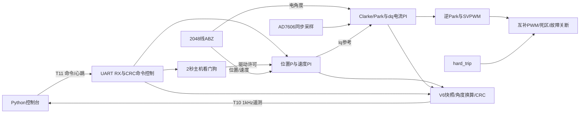

# FPGA FOC：20kHz电流环 / 1kHz速度与位置环

本项目在AX7Z020（`xc7z020clg400-2`）上实现带编码器的三相电机FOC，支持**串口速度控制和多圈角度定位**。主时钟50MHz，PWM/电流环20kHz，速度/位置环及遥测1kHz。当前使用2048线ABZ编码器，四倍频8192计数/圈。

本目录由当前已验证的串口控制版本整理而来。25个生产RTL及有效引脚约束保持一致，VIO、按键控制和ADC_CTRL均未引入；历史采样、旧固件、调试缓存和大批中间测试结果不在本目录中。上位机统一位于tools。**本次是工程整理，没有重新整定低速性能或修复已观察到的零星串口丢字节。**

## 1. 快速使用

1. 用Vivado2024.2打开 [project_1/project_1.xpr](project_1/project_1.xpr)。已有可下载固件在 [project_1/output/TOP.bit](project_1/output/TOP.bit)，无需LTX。
2. FPGA TX：J20-10/T10→USB串口RX；FPGA RX：J20-9/T11←USB串口TX；逻辑侧共地。默认COM11、1500000baud、8N1、无流控。
3. 双击 [tools/Start_Motor_Console.cmd](tools/Start_Motor_Console.cmd)。控制台接入先发送停止并读回，设备就绪后才允许启动。
4. 选择速度模式，设置0～3000rpm；或完全停机后选择角度定位，输入目标度数及运动限速。点击启动，运行中可发送新目标。
5. 结束运动点击“停止”/Esc。正常关闭窗口也会发送停止并等待驱动关闭；失联超过2秒撤销驱动许可，恢复连接不会自动启动。

首次启动仍包含预对齐、慢速寻Z和电角度对齐运动。定位模式在启动完成处建立本次0°，随后执行目标。到位保持与停止不同：到位后start=1仍有保持力矩；停止后撤销驱动，不再保持。

## 2. 目录

```text
FOC_20KHz_1KHz/
├─ doc/                         必要硬件资料、完整UART协议、验证摘要及源码清单
│  ├─ HKT56.pdf
│  ├─ 1NSPC136001D_APUS2.pdf
│  ├─ DRAWING_140324.pdf
│  ├─ IO_J20.png / IO_J21.png
│  ├─ hardware.md               从当前XDC整理的完整端口/管脚表
│  ├─ uart_protocol.md          命令、回执、V6遥测的逐字节定义
│  ├─ validation.md             整理验证及已知限制
│  └─ source_manifest.json      主文件SHA256清单
├─ project_1/
│  ├─ project_1.xpr             Vivado工程；引用根目录XDC及相对源码路径
│  ├─ scripts/                  创建、构建、下载与强制时序检查脚本
│  └─ output/
│     ├─ TOP.bit                已实机验证的当前固件
│     └─ SHA256.txt             随附固件摘要；重新构建后需重新计算
├─ rtl/                         25个TOP生产依赖模块
├─ sim/                         4个关键自检testbench及run_sim.ps1
├─ tools/                       Python控制台、启动脚本和requirements.txt
│  └─ monitor_output/           运行后自动生成，交付时不带历史采样
├─ foc.tcl                      可迁移的工程创建/刷新入口
├─ foc.xdc                      唯一生效的板级引脚与时序约束
└─ readme.md
```

Vivado后续正常运行会产生cache、runs、sim等目录；它们属于可再生成的构建结果。源码及构建脚本不依赖旧foc_test目录、旧VIO IP、旧DCP或历史采样文件。原foc_test工程及历史归档仍保留在原位置。

## 3. 环境与工程重建

已验证工具为Vivado2024.2、Windows和本机Python环境。上位机依赖NumPy、pyqtgraph、PyQt5及pyserial，安装命令：

```powershell
# 以下命令均在本项目根目录运行
python -m pip install -r tools/requirements.txt
```

通常直接打开project_1.xpr即可。需要重新创建工程，或将整个目录复制到其他位置后，可在Vivado Tcl Console执行 `source <新项目路径>/foc.tcl`，执行前先关闭其他工程。批处理入口：

```powershell
# 只创建/刷新XPR，不综合，不连接硬件
& C:/Xilinx/Vivado/2024.2/bin/vivado.bat -mode batch -source project_1/scripts/create_project.tcl
# 从综合开始完整重建，不连接硬件
& C:/Xilinx/Vivado/2024.2/bin/vivado.bat -mode batch -source project_1/scripts/build.tcl
```

完整构建会重置综合/实现结果，将新的TOP.bit和主要时序报告放到project_1/output；运行详细文件在project_1/project_1.runs。GUI正常Run Implementation / Generate Bitstream也使用相同的时序检查挂钩；GUI原生bit输出位于project_1/project_1.runs/impl_1/TOP.bit。

约束为50MHz、ADC并行读回多周期及硬故障到七路驱动输出10ns最大延时。布局阶段暂用8ns目标，布线后恢复原10ns预算签核，setup/hold或任一路故障关断不通过时阻止写bit。没有排除这些硬故障关断路径。仿真文件仅用于sim_1，无生产IP依赖。

在Hardware Manager连接板卡后下载TOP.bit，清空旧probes/LTX配置。提供的命令行下载脚本使用当前已确认的Digilent适配器编号210512180081；换适配器需修改脚本中的选择条件，或使用GUI。先启动本机hw_server，再执行：

```powershell
& C:/Xilinx/Vivado/2024.2/bin/vivado.bat -mode batch -source project_1/scripts/program_foc.tcl
# 可选指定另一固件目录（目录内需含TOP.bit）
# ... -tclargs D:/path/to/image
```

下载仅写入易失FPGA配置，不烧写Flash；掉电后需重新下载。控制参数也不掉电保存。

## 4. 架构与RTL



| 模块 | 职责 |
|---|---|
| TOP | 复位、UART、看门狗、驱动和遥测连接 |
| FOC_UART_RX / FOC_UART_CONTROL | 三级同步、1.5Mbps接收、CRC/范围/状态检查、参数及回执、角度转计数 |
| FOC_HOST_WATCHDOG | 主机在线租约与显式停止重新使能 |
| FOC_SPEED_DRIVE | 位置/速度/电流闭环系统连接、增益调度 |
| FOC_POSITION_CONTROLLER | 多圈位置累计、位置P、限速、到位与越界保护 |
| FOC_SPEED_ESTIMATOR / FOC_SPEED_CONTROLLER | AB测速、斜坡、正反速度PI、停机及堵转保护 |
| FOC_MOTOR_CORE / FOC_STARTUP | 电流闭环、零偏/寻Z/对齐/运行状态与故障管理 |
| ADC_DRIVER / FOC_CURRENT_SENSE | AD7606采样读回、零偏、三相增益与电流换算 |
| HKT56_ENCODER_IF / FOC_ENCODER_ANGLE | ABZ同步滤波、四倍频、Z检查、机械/电角度 |
| Clark_trans / Park_trans / FOC_CURRENT_TRANS | 三相电流到dq的定点变换与流水对齐 |
| FOC_PI | dq电流PI、限幅及抗积分饱和 |
| FOC_INVERSE_PARK / FOC_SINCOS_LUT | 逆变换与正余弦查表 |
| FOC_SVPWM / FOC_PWM_DRIVER / FOC_OUTPUT_GUARD | 调制、分数PWM、周期锁存、死区和异步故障关断 |
| FOC_SPEED_UART_MONITOR / usart_tx | 遥测快照/CRC与UART发送 |

所有25个生产模块均属于TOP依赖，没有key_val、VIO、ADC_CTRL或旧同步电流诊断缓存。

## 5. 硬件接口与固定配置

完整端口表见 [doc/hardware.md](doc/hardware.md)，原连接器图片见 [IO_J20](doc/IO_J20.png)、[IO_J21](doc/IO_J21.png)。根目录foc.xdc为唯一构建依据。

| 接口 | 连接/有效性 |
|---|---|
| 时钟/复位 | sys_clk=U18，50MHz；sys_rst_n=M15，低有效 |
| 编码器 | A=R14、B=P14、Z=U12；J20-3/4/5 |
| UART | FPGA TX=T10/J20-10；RX=T11/J20-9；3.3V逻辑 |
| AD7606控制 | CONVST=K19/J21-5；RESET=A20/J21-8；BUSY=B20/J21-9；CS=C20/J21-10；RD=B19/J21-7 |
| AD7606过采样 | OS0=M17/J21-4，OS1=M18/J21-3，OS2=J19/J21-6；输出000关闭过采样 |
| 三相高桥PWM | U/V/W：P19、R17、P15；高有效 |
| 三相低桥PWM | U/V/W：N18、R16、P16；高有效 |
| 驱动使能/硬故障 | motor_sd_a_o=P18，高表示允许；hard_trip_i=V16，高关断，内部上拉 |

AD7606 CONVST A/B已短接一起驱动，采用并行16位接口，前三通道为三相电流。数据总线引脚见完整表；采集板与FPGA逻辑侧共地。编码器信号须经现有接口/电平转换送入3.3V FPGA，不能将超出FPGA电平范围的输出直接接入。

| 固定配置 | 当前生效值/位置 |
|---|---|
| PWM/电流周期 | 2500个50MHz时钟=50µs，20kHz |
| 速度/位置周期 | 1ms，1kHz |
| 电机极对数 | 4；FOC_MOTOR_CORE |
| 编码器分辨率 | 2048线×4=8192计数/圈 |
| 死区 | 50个时钟=1µs |
| 电流内部精度 | dq保留8位小数，PWM保留16位分数状态 |
| 电流采样增益 | 三相默认CURRENT_GAIN_Q16=−62500；保持当前采样符号约定 |
| Iq命令上限 | 200mA；可经串口在0～200mA内设定 |
| 相电流峰值保护 | 500mA；独立于Iq命令上限 |
| 启动寻零/对齐电流 | 150mA |
| 速度斜坡 | 加速600rpm/s、减速1000rpm/s |

电流比例及驱动有效电平针对当前接线与已验证硬件；更换电机、采样板或驱动时应核对相应参数。运行时可调参数见下一节，其他参数通过RTL重新构建。

## 6. 上位机操作与参数

左侧为运动目标、启停、限流和环路系数，右侧为实时状态、曲线与统计。速度使用rpm，位置统一使用度。

```powershell
# 换串口或指定Python解释器
./tools/Start_Motor_Console.cmd -Port COM12
./tools/start_speed_monitor.ps1 -Python C:/Path/To/python.exe
# 只读窗口，不发命令或心跳
./tools/start_speed_monitor.ps1 -ReadOnly
# 只记录10秒，不发命令或心跳
./tools/start_speed_monitor.ps1 -NoPlot -Seconds 10
# 离线回放，兼容V2/V3/V5/V6
python tools/monitor_speed.py --input tools/monitor_output/speed_时间戳.bin --output tools/monitor_output/replay
```

| 参数 | 范围/限制 | 上电默认 |
|---|---|---:|
| start | 0停止、1启动 | 0 |
| mode | 0速度、1角度定位；完全停机后改 | 0 |
| 速度/定位限速 | 0～3000rpm；启动要求大于0 | 300rpm |
| 绝对位置目标 | GUI用度；串口signed32毫度，约±2147483.647° | 0° |
| Iq上限 | 0～200mA；为0拒绝启动 | 200mA |
| 速度Kp | 0～10，完全停机后改 | 1 |
| 速度Ki | 0～1，1ms离散系数 | 655/65536≈0.009995 |
| 电流Kp | 0～16，完全停机后改 | 2 |
| 电流Ki | 0～1，20kHz离散系数 | 0.0625 |
| 位置Kp | 0～10/s，完全停机后改 | 4/s |

环路系数在界面输入普通数值，内部转换Q16；保留原低速增益调度。运行中可修改目标和Iq上限，模式/增益写入需完全停机，非法命令不会覆盖原值。事件区显示请求回执，“载入设备当前参数”同步最新读回值。

速度设0按原斜坡减速，之后改正数可以继续；需要结束本次运动时使用停止。角度是相对本次启动零点的**绝对目标**：90°改成180°会再走约90°；360°是一圈，−720°是反向两圈；改成0°返回本次零点。STOP清除旧目标，每次启动完成后重新建零，故不是掉电保持的绝对编码器坐标。

每计数约0.043945°，目标会舍入至最近计数；传输0.001°小数不代表机械绝对精度达到0.001°。到位判据是误差±2计数且速度±1rpm持续100ms，不能等同于持续保持精度。位置控制沿用比例P及速度斜坡，未增加完整轨迹规划。

## 7. 串口、绘图与记录

下行命令固定16字节、CRC16-CCITT、带请求序号；上行V6固定96字节、1kHz，带参数回读和最近回执。位置指令用signed32毫度，位置遥测用signed64毫度；各字段大端，CRC多项式0x1021、初值0xFFFF。逐字节定义见 [doc/uart_protocol.md](doc/uart_protocol.md)。

上位机单线程负责串口写入、回执/重试及心跳；首次连接、恢复或检测到设备重启时先停止，不自动恢复旧启动。看门狗固定开启，2秒没有合法心跳/成功命令即撤销驱动许可并清除旧启动/目标。正常STOP是受控减速，失联关断驱动不保证同样的制动过程。暂停曲线仍持续采集、记录及心跳；只读模式不维持另一个控制会话。

默认1kHz全量采集、60Hz绘图。速度模式显示设定/斜坡/实际rpm、实际−设定误差和dq电流；定位模式显示目标/实际角度、目标−实际误差和电流。默认最近5秒统计，符合稳定目标条件后先等待1秒，提供均值/偏差/峰峰值/标准差/最大绝对误差/RMSE及编码器累计位置均速；定位模式不把运动限速当作稳态速度目标。

采集结果自动写入tools/monitor_output：`.bin`原始数据、`.csv`全帧、`_speed_stats.csv`滚动统计、`.summary.json`摘要及手动截图。这些均在使用后生成，不作为工程源码交付。COM口不能同时被本窗口、SerialPlot或串口助手占用。

**CRC错误与缺帧**是遥测通信计数。同一坏帧可能同时增加两项；接收1000Hz而绘图约60fps正常。运行中CRC/缺帧持续增加仍需排查，本次整理不隐藏或清零这些计数。最近一次已有完整记录中556469个有效帧、14次异常，多数异常报文少1字节，来源未确定；当前不能声称通信已无丢失。它不等同于FPGA内部控制周期漏执行，但会影响曲线数据完整性。

## 8. 仿真与验证

```powershell
# 全部4项关键自检，默认结果写入系统TEMP，避免污染项目
./sim/run_sim.ps1
# 指定结果位置或单项顶层
./sim/run_sim.ps1 -OutputDir D:/temp/foc_sim -TopNames tb_foc_uart_top
```

| Testbench | 覆盖 |
|---|---|
| tb_foc_uart_rx | 256字节、连续1.5Mbps、±2%速率差、毛刺/错误停止位恢复 |
| tb_foc_uart_control | CRC/ACK/读回、角度极值、边界、重复命令、软复位、失联重新使能 |
| tb_foc_control_uart | V6 96字节、CRC、1kHz时序、角度/参数一致快照 |
| tb_foc_uart_top | 真实RX→TOP、AD7606/ABZ/RL/PWM、启动/停止/角度/故障复位/失联 |

本目录保留关键验证源码，不带旧阶段全部比较模型和结果。整理前版本已完成34项RTL、33项PC/Qt测试以及300/600rpm和正反角度/多圈定位板测；随附TOP.bit即该实机版本。整理后的复核状态、时序/资源、精度边界和源码摘要见 [doc/validation.md](doc/validation.md)。本次整理不连接串口、不下载板卡、不启动电机。

## 9. 状态、故障与常见问题

启动状态为：0零偏→1等待→2预对齐→3寻Z→4对齐→5角度标定→6运行；7故障。只有就绪后才接受启动，命令回执成功不代表定位已完成，应同时看到位位及误差。

| 故障码（十六进制） | 含义 |
|---|---|
| 00 | 无故障 |
| 01 | 外部硬故障 |
| 02 | ADC超时/采样截止时间异常 |
| 03 | 编码器/角度异常 |
| 04 | 电流采样满量程或相电流保护 |
| 05 | 启动寻Z超时 |
| 06 | PWM采样窗口不安全 |
| 07 | 电流控制更新超时 |
| 08 | 编码器速度越界保护 |
| 09 | 速度环堵转 |
| 0A | 停机超时 |
| 0B | 对齐超时 |
| 0C | 多圈位置越界 |

故障后确认驱动已关闭，再使用“故障/控制复位”。软复位重做电机采样/控制状态，保留通信、参数和回执，复位后不会自动启动。外部hard_trip仍为高时，不能通过复位消除其物理原因；看门狗失联撤销许可本身不锁存上述故障码。

打不开串口时先关闭其他占用程序；缺Python包按requirements安装；界面接收为0时检查板卡是否已下载当前固件、TX/RX是否交叉及共地；ADC故障按hardware.md核对并行线、BUSY、CONVST A/B、过采样与供电。工程迁移后有旧路径时关闭旧Vivado会话，再运行本目录foc.tcl重新刷新。
